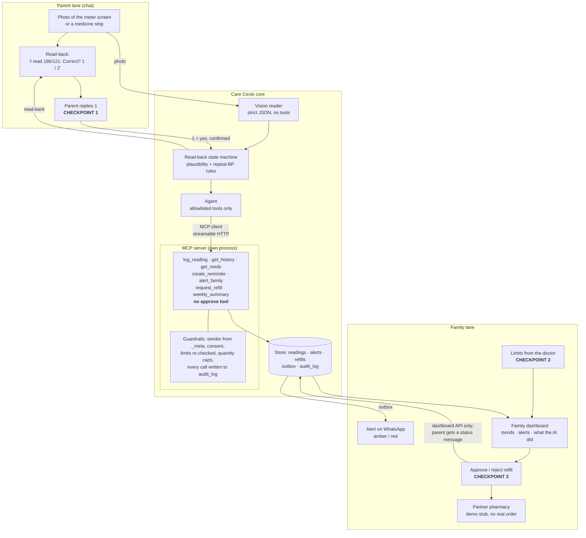
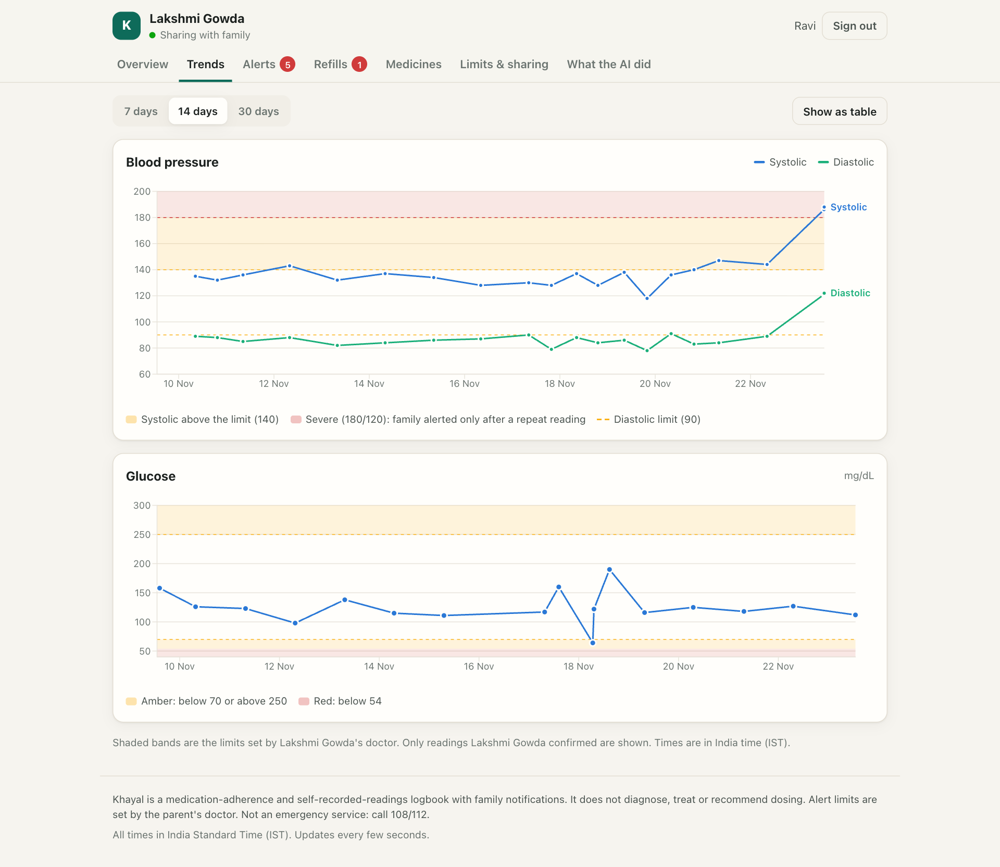
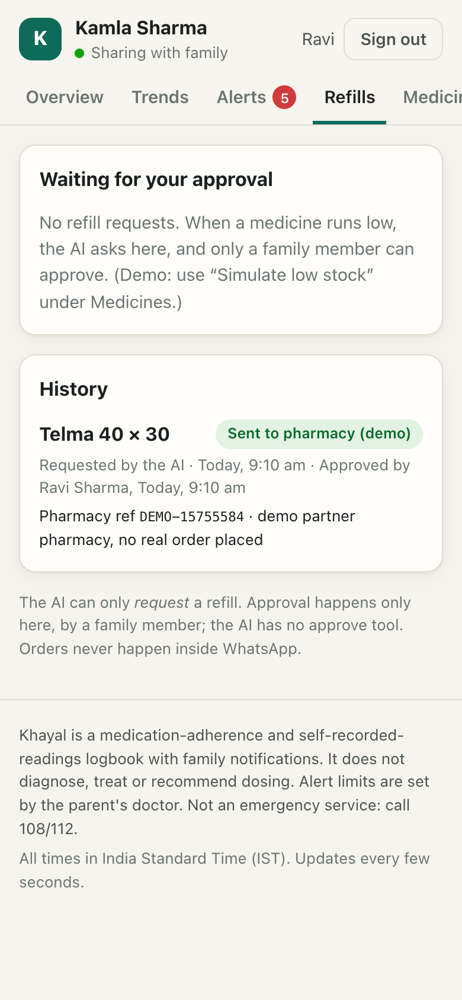
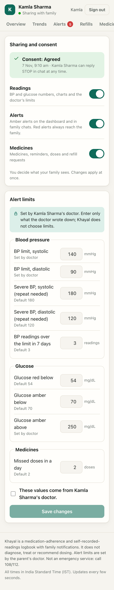

# Care Circle

**A WhatsApp photo of any ordinary glucometer or BP monitor becomes a confirmed, logged reading
and a family that knows. No new app, no new device.**

Built for wHACKiest 2026, Track 1, "Make MCP Matter: Less Magic, More Utility".
The most controlled MCP product in the room: **the model can log, remind and *request*. It
cannot approve, prescribe or diagnose, because the approve tool does not exist on its side.**

> **Intended use.** Care Circle is a medication-adherence and self-recorded-readings logbook with
> family notifications. It does not diagnose, treat or recommend dosing. Alert limits are set by
> the parent's doctor. Not an emergency service: call 108/112.

<p>
  
  
</p>

## Problem

**India's elderly parents manage BP and diabetes alone, and families find out too late.**

| Fact | Source |
|---|---|
| 149M Indians aged 60+ in 2022 (10.5%), rising to 347M (20.8%) by 2050 | IIPS/UNFPA India Ageing Report 2023 |
| 36.2% of people aged 60+ have hypertension (measured); 14.2% have diagnosed diabetes | LASI Wave 1 factsheet |
| Only ~10.4% of hypertensive adults aged 45+ have their BP under control | Bhatia et al. 2021 (LASI data) |
| Uncontrolled hypertension is behind 52% of India's cardiovascular deaths | WHO hypertension report 2023 |
| Medication adherence for chronic (NCD) conditions is 51%; 37.5% have 2+ conditions | Tolley et al. 2023 (WHO-SAGE India) |
| 55.6% of rural elders with BP + diabetes are non-adherent; forgetfulness is a driver and family support helps | Jeyalakshmi et al. 2023 |
| 36% of older parents have a migrant child; 35% are empty nesters | Sarkar et al. 2023 (LASI) |
| WhatsApp has ~500M users in India | Meta Q2 2024 earnings call (TechCrunch) |
| Only ~40% of urban elders have a smartphone; 66% find digital tools "too confusing"; 5% use health or banking apps | HelpAge India 2024/2025 |

A real example: in Chennai in April 2024, an 82-year-old man living alone, with his son in the
US, was found only after a phone call went unanswered (DT Next). No one was watching.

Honest framing: Care Circle is for elders who have a smartphone with WhatsApp, or a spouse or
caretaker who helps. The numbers already exist on the meter screen at home; they just never
reach the family.

## Solution

1. **Photo vitals.** The parent sends a photo of the BP monitor or glucometer screen. The reader
   extracts the numbers and reads them back ("I read 142/88. Correct? Reply 1 yes / 2 no").
   Nothing is logged as confirmed, and no alert fires, until the parent says yes.
2. **Tiered family alerts** (amber / red) against limits set by the doctor, with a
   repeat-reading rule for severe BP.
3. **Medicine-strip photo** → brand matched to a generic → daily reminder (after confirmation).
4. **Family-approved refills.** Low stock → the AI *requests* a refill → a family member approves
   on the dashboard → licensed partner pharmacy (outside WhatsApp; a labelled stub in this demo).
5. **Family dashboard:** trends, alerts, pending approvals, medicines, doctor-set limits,
   sharing and consent, and a live log of every tool call the AI made.
6. Coming next: voice notes in Indian languages and a weekly descriptive summary (Phase 5).

### Three human checkpoints

| # | Who | Decides | Enforced where |
|---|---|---|---|
| 1 | **Parent** | Is this the right reading? ("1 yes / 2 no") | `log_reading` only stores `unconfirmed`; confirmation is the parent's reply, handled server-side. `alert_family` refuses unconfirmed readings. |
| 2 | **Doctor** | What counts as too high or too low | Limits are stored as `set_by=doctor`, edited on the dashboard behind "these values come from the doctor", and re-checked by the server on every alert. The AI cannot change them. |
| 3 | **Family** | Should this refill be ordered? | `request_refill` only creates `pending_approval`. Approval exists only at `POST /api/refills/{id}/approve`, after a family member's click. There is no `approve_refill` MCP tool (a test guards this). |

## Architecture



- `backend/app/`: FastAPI app (channel webhooks, web simulator, dashboard API, built dashboard at
  `/dashboard`), the read-back conversation engine and the rule-based agent.
- `backend/mcp_server/`: the FastMCP server, run as its own process. The agent calls it through
  a real MCP client over streamable HTTP. The parent's identity travels in the request `_meta`
  set by our backend, never in tool arguments the model writes.
- `dashboard/`: React + Vite + TypeScript + Recharts family dashboard.
- Adapters picked in `.env`: channel (simulator / telegram / twilio), LLM (mock / groq /
  bedrock), storage (sqlite / dynamodb), voice (none / elevenlabs).

### MCP tools and their guardrails

| Tool | What the AI can do | Guardrails (server-side) |
|---|---|---|
| `log_reading` | Store a BP or glucose reading | Stored as **unconfirmed** only; implausible values are rejected (asks for a retake); parent resolved from `_meta`, never from arguments |
| `get_history` | Read confirmed readings (today / 7d / 14d / 30d) | Read-only; only the sender's own data |
| `get_meds` | Read medicines, reminder times and stock | Read-only |
| `create_reminder` | Set daily reminder times | Only for medicines the parent confirmed; `HH:MM` validated |
| `alert_family` | Tell the family a limit was crossed | Reading must be confirmed; server re-evaluates the doctor's limits; cannot escalate amber→red; first severe BP needs a repeat; amber capped at 3/day (red never capped); deduped per reading; family sees server-written text only; nothing sent if the parent does not share alerts |
| `request_refill` | Ask the family to approve a refill | Creates `pending_approval` only; capped at one month's supply; Schedule X refused; one pending per medicine; refused if the parent does not share medicines |
| `weekly_summary` | Descriptive 7-day summary | Output filter blocks diagnosis and dosing words |
| ~~`approve_refill`~~ | **Does not exist** | Approval lives only in the dashboard API, triggered by a family member |

All tools refuse a parent whose consent is pending, paused or revoked. Every call, including
refusals, is written to `audit_log` and shown as "What the AI did" in the simulator and dashboard.

## Run in 2 minutes

Mock mode needs **no API keys**. Prerequisites: Python 3.11+,
[uv](https://docs.astral.sh/uv/) (`pip install uv`), Node 20+.

```bash
git clone https://github.com/jagpreetsingh02/care-circle.git
cd care-circle
cp .env.example .env                         # APP_MODE=mock, no keys needed

(cd dashboard && npm install && npm run build)   # once: builds the dashboard

cd backend
uv sync
uv run python ../scripts/start.py --seed     # 14 days of demo data, MCP server + API
```

Then open, on one port:

- **Simulator:** http://localhost:8000/simulator (the parent's chat, the children's phones, the MCP log)
- **Dashboard:** http://localhost:8000/dashboard/ (token `change-me`, i.e. `DASHBOARD_DEMO_TOKEN`; sign in as Ravi or Priya)

### Demo script (golden path, all mock)

1. **Simulator:** 🖼️ → `bp high` → "I read 186/122. Correct?" → **1**. The parent is asked to rest
   5 minutes; the family is *not* alerted on a first severe reading.
2. **⏩ Skip 5 minutes** → 🖼️ `bp high` again → **1** → **RED alert** in both children's phones.
   On the dashboard, the alert appears within seconds and **Trends** shows the spike above the
   doctor's band. Tap **I've seen this**.
3. 🖼️ `strip telma40` → "Telma 40 = Telmisartan 40 mg. Remind at 8 PM?" → **1** → reminder set.
4. **Dashboard → Medicines → Simulate low stock (demo)** on Telma 40. The AI calls
   `request_refill` over MCP; the children get "Refill request…" in the simulator.
5. **Overview → Approve.** The refill goes to the demo partner pharmacy (no real order). The
   parent's chat shows "Refill approved for Telma 40 (30); your pharmacy will confirm."
   Approving twice is safe; the first click wins.
6. **What the AI did:** every MCP tool call, plus the family's approval. Approvals by the AI: **0**.
7. Sign out, sign in as **Kamla** (the parent) → **Limits & sharing** → turn off *Medicines*.
   Signed in as Ravi again, medicines and refills now say "not shared". Parent-first.

Type `what's the weather?` in the parent chat: "I can only help with readings and medicines."
**Reset demo** in the simulator starts a fresh family with consent *pending* (the onboarding
path: `hello` → consent notice → **1**).

### Screenshots

| Trends with doctor-set bands | What the AI did |
|---|---|
|  |  |

| Refill history (phone) | Sharing and limits (parent's view) | Alerts |
|---|---|---|
|  |  |  |

Regenerate them with `uv run --with playwright python ../scripts/screenshots.py` while the demo is
running (dev-only; uses your installed Chrome).

### Developing

```bash
# from backend/
uv run pytest                                      # backend tests + dashboard build/lint check
uv run ruff check . && uv run ruff format --check .
uv run python ../scripts/start.py                  # keep the current database
uv run python ../scripts/seed_demo.py              # reseed (stop the servers first)
uv run python ../scripts/mcp_client_demo.py        # list MCP tools, call log_reading
uv run python ../scripts/chat_demo.py --demo       # the conversation in the terminal
uv run python ../scripts/accuracy_test.py          # reader accuracy on samples/

# from dashboard/ (hot reload on http://localhost:5173/dashboard/, /api proxied to :8000)
npm run dev
npm run lint
```

Dashboard API (all routes need the demo session): `GET /api/parents/{id}/readings?range=14d`,
`GET /api/alerts` + `POST /api/alerts/{id}/acknowledge`, `GET /api/refills?status=…`,
`POST /api/refills/{id}/approve|reject`, `GET /api/parents/{id}/medicines`,
`GET|PUT /api/parents/{id}/thresholds`, `GET|PUT /api/parents/{id}/sharing`, `GET /api/audit`.
Interactive docs at http://localhost:8000/docs.

## Enabling real providers

- **Vision reader (Groq):** `LLM_PROVIDER=groq`, `GROQ_API_KEY`; 📎 in the simulator then uploads
  a real photo. The free tier allows about 3 photos a minute.
- **Telegram:** `CHANNEL=telegram` and `TELEGRAM_BOT_TOKEN` (from @BotFather). The API long-polls,
  so no public URL is needed. Send `/id` to your bot, then register yourself:
  `uv run python ../scripts/add_member.py --channel telegram --ref <id> --role parent --name "Me"`.
- **WhatsApp (Twilio Sandbox):** `CHANNEL=twilio`, `TWILIO_ACCOUNT_SID`, `TWILIO_AUTH_TOKEN`,
  `PUBLIC_BASE_URL` (e.g. an ngrok https URL) and the Sandbox webhook set to
  `<PUBLIC_BASE_URL>/webhooks/twilio`. Requests without a valid `X-Twilio-Signature` are
  refused. Alerts to numbers outside the 24-hour window need `TWILIO_TEMPLATE_CONTENT_SID`.
- **Dashboard:** set your own `DASHBOARD_DEMO_TOKEN` before showing it to anyone.

## Safety and privacy

- **A logbook, not a medical device.** Summaries and alerts describe numbers against limits the
  doctor set; they never interpret, diagnose or suggest doses (CDSCO's 2026 software guidance
  excludes data-management software). Red alerts always say "If you feel unwell, call 108/112".
- **Reading accuracy is unproven, so every reading is read back.** Strict JSON schema,
  rule-based plausibility checks and mandatory parent confirmation. We will report an accuracy
  number only after measuring it on real photos.
- **Parent consents, not the child.** The parent agrees in chat, can reply STOP at any time, and
  chooses what the family sees (readings, alerts, medicines). Children cannot change it. While
  paused, nothing is logged, alerted or reminded. SPDI-compliant today, built for DPDP (consent
  duties start 13 May 2027). We do not claim end-to-end encryption.
- **Refills happen off WhatsApp.** WhatsApp's policy prohibits drug sales, so chat only carries
  status messages. Orders go to a licensed pharmacy that checks the prescription (a clearly
  labelled stub here). Schedule X medicines are excluded; quantities are capped server-side.
- **Narrow bot.** Only readings, medicines, reminders and refills; anything else gets a fixed
  refusal (general-purpose AI chatbots are banned on the WhatsApp Business API).
- **Prompt injection.** Text inside a photo is data. The vision call has no tools, and every
  limit and cap is enforced by the server, not by the prompt.
- **Data minimisation.** Photos are read and dropped; only the numbers are kept. Every AI tool
  call and every family decision is in the audit log. The MCP server binds to localhost.

## Roadmap

- [x] Phase 0: repo setup, scaffolds, smoke tests
- [x] Phase 1: MCP core and storage (tools, thresholds, audit log)
- [x] Phase 2: photo reader and read-back confirmation
- [x] Phase 3: channels and agent, golden path in the web simulator
- [x] Phase 4: family dashboard and refill approval
- [ ] Phase 5: voice replies, reminder scheduler, low-stock detection, weekly summary
- [ ] Phase 6: AWS deployment (Mumbai region), polish and measured reading accuracy

## Team

_To be added._
