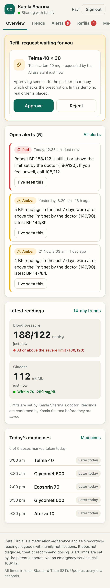
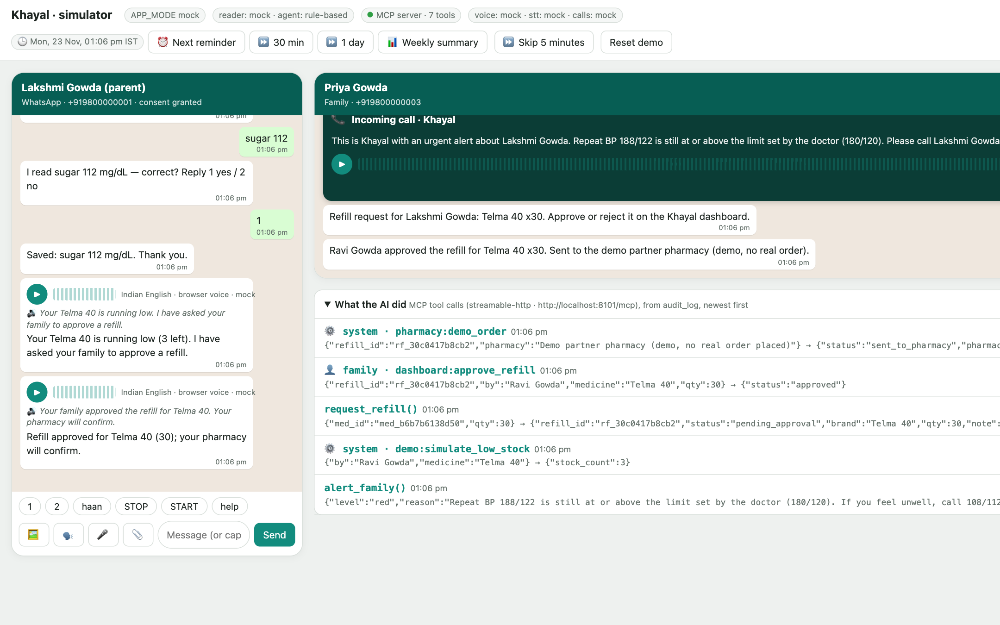
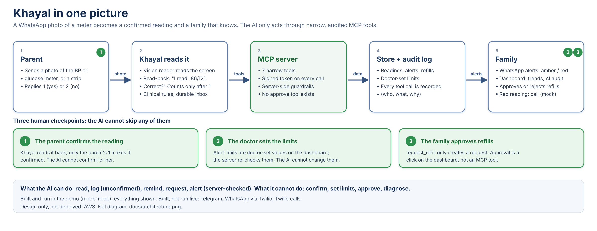
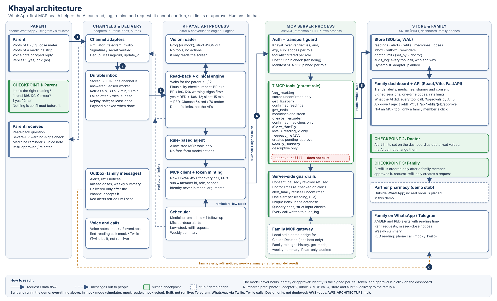

# Khayal

[](https://github.com/jagpreetsingh02/Khayal/actions/workflows/ci.yml)

**A WhatsApp photo of any ordinary glucometer or BP monitor becomes a confirmed, logged reading
and a family that knows. No new app, no new device.**

Team SHERRR, wHACKiest 2026, Track 1: Make MCP Matter.

[Demo script](docs/DEMO_SCRIPT.md) · [Pitch facts](docs/PITCH_FACTS.md) ·
[Family MCP](docs/FAMILY_MCP.md) · [AWS architecture](docs/AWS_ARCHITECTURE.md)

## At a glance

| | |
|---|---|
| **Problem** | India's elderly parents manage BP and diabetes alone, and families find out too late. The numbers are on the meter screen at home; they never reach the family. |
| **Solution** | The parent sends a photo of the meter screen. Khayal reads it back, logs it once the parent confirms, alerts the family against limits the doctor set, sends medicine reminders, and asks the family to approve refills on a dashboard. |
| **Why MCP** | The AI can only act through 7 narrow, audited MCP tools. It can log, remind and *request*. It cannot approve, prescribe or diagnose: no approve tool exists. Three human checkpoints: the parent confirms each reading, the doctor sets the limits, the family approves refills. |
| **Real in this demo** | The MCP server (its own process, a signed token per call, scopes per role, audit log), the guardrails, the clinical rules, the read-back flow, reminders, message retries and the family dashboard. Mock mode simulates WhatsApp, the AI reader and the voice notes. |
| **Not built yet** | Accuracy on real photos; AWS deployment (design only, nothing deployed); family MCP over OAuth (planned, not built); DPDP export / delete. Telegram, WhatsApp via Twilio and Twilio calls are built but not run live. |

> **Intended use.** Khayal is a medication-adherence and self-recorded-readings logbook with
> family notifications. It does not diagnose, treat or recommend dosing. Alert limits are set by
> the parent's doctor. Not an emergency service: call 108/112.

<p>
  
  
</p>

## Why it matters

| Fact | Source |
|---|---|
| 149M Indians aged 60+ in 2022 (10.5%), rising to 347M (20.8%) by 2050 | IIPS/UNFPA India Ageing Report 2023 |
| Only ~10.4% of hypertensive adults aged 45+ have their BP under control | Bhatia et al. 2021 (LASI data) |
| Medication adherence for chronic (NCD) conditions is 51% | Tolley et al. 2023 (WHO-SAGE India) |
| WhatsApp has ~500M users in India | Meta Q2 2024 earnings call (TechCrunch) |

Honest framing: Khayal is for elders who have a smartphone with WhatsApp, or a spouse or
caretaker who helps. The numbers already exist on the meter screen at home; they just never
reach the family.

All nine facts with sources, and a real example: [docs/PROBLEM_AND_SOURCES.md](docs/PROBLEM_AND_SOURCES.md).

## How it works

1. **Photo vitals.** A photo of the meter screen is read back ("I read 142/88. Correct? Reply 1 yes / 2 no"); nothing is confirmed or alerted until the parent says yes.
2. **Tiered family alerts** (amber / red) against doctor-set limits, with a repeat-reading rule for severe BP.
3. **Medicine-strip photo** → brand matched to a generic → daily reminder, after confirmation.
4. **Family-approved refills.** The AI *requests*, a family member approves on the dashboard, a licensed pharmacy fills it outside WhatsApp (a labelled stub here).
5. **Family dashboard:** trends, alerts, approvals, medicines, doctor-set limits, sharing and consent, and every AI tool call.
6. **Reminders and voice.** Reminders, missed-dose alerts, a weekly summary, voice notes (English and Hindi), and a call for a confirmed red reading (mock here).

### Three human checkpoints

| # | Who | Decides | Enforced where |
|---|---|---|---|
| 1 | **Parent** | Is this the right reading? ("1 yes / 2 no") | `log_reading` only stores `unconfirmed`; confirmation is the parent's reply, handled server-side. `alert_family` refuses unconfirmed readings. |
| 2 | **Doctor** | What counts as too high or too low | Limits are stored as `set_by=doctor`, edited on the dashboard behind "these values come from the doctor", and re-checked by the server on every alert. The AI cannot change them. |
| 3 | **Family** | Should this refill be ordered? | `request_refill` only creates `pending_approval`. Approval exists only at `POST /api/refills/{id}/approve`, after a family member's click. There is no `approve_refill` MCP tool (a test guards this). |

### Architecture




Detailed view:



*Vector versions: [docs/architecture-simple.svg](docs/architecture-simple.svg) and [docs/architecture.svg](docs/architecture.svg). Built, not run live: Telegram, WhatsApp via Twilio and Twilio calls. AWS is design only, nothing deployed.*

- `backend/app/`: FastAPI app (channels, web simulator, dashboard API), the read-back engine and
  the rule-based agent.
- `backend/mcp_server/`: the FastMCP server, its own process, called over streamable HTTP. Each
  call carries a 60-second token signed by our backend for the parent (`sub`), never a tool
  argument ([security](docs/SECURITY.md#security)).
- `dashboard/`: React + Vite + TypeScript + Recharts family dashboard.
- Adapters picked in `.env`: channel (simulator / telegram / twilio), reader (mock / groq;
  bedrock is a stub), storage (sqlite; dynamodb planned), voice (none / mock / elevenlabs),
  calls (none / mock / twilio).
- **On AWS (design only, nothing deployed):** Bedrock, DynamoDB, Cognito and WhatsApp messaging
  in Mumbai (ap-south-1). Built versus designed: [docs/AWS_ARCHITECTURE.md](docs/AWS_ARCHITECTURE.md).

## The MCP design

| Tool | Reads or acts | Key server-side guardrail |
|---|---|---|
| `log_reading` | Acts | Stored as **unconfirmed** only; implausible values refused; the parent comes from the signed token, never from arguments |
| `get_history` | Reads | A parent reads only their own; a family token reads its own family's parent, only if readings are shared |
| `get_meds` | Reads | A parent: own medicines; a family token: only if the parent shares medicines |
| `create_reminder` | Acts | Only for medicines the parent confirmed; the note refuses links, phone numbers and instructions |
| `alert_family` | Acts | Takes only `level` and `reading_id` (no recipient, no text); reading must be confirmed; the server re-checks the doctor's limits |
| `request_refill` | Acts | Creates `pending_approval` only; capped at one month's supply; Schedule X refused |
| `weekly_summary` | Reads | No recipient or text; output filter blocks diagnosis and dosing words |

`approve_refill` does not exist, and a test guards it: approval lives only in the dashboard API,
triggered by a family member. Every call, including refusals, is written to `audit_log` and
shown as "What the AI did". A family token lists and calls only the three read tools.
Annotations, output schemas, scopes and the full guardrail list: [docs/MCP_TOOLS.md](docs/MCP_TOOLS.md).

### Clinical rules (summary)

From the 2025 AHA/ACC blood-pressure guideline and the ADA Standards of Care 2026; the doctor's
limits are set on the dashboard. Full rules: [docs/CLINICAL_RULES.md](docs/CLINICAL_RULES.md).

- **Severe BP** (default 180/120): a warning-signs question first. Yes = RED and "call 108/112".
  No = rest 5 minutes and repeat; still severe = RED "contact her doctor today". No answer and
  no repeat within 15 minutes = RED.
- **Glucose** below 54 mg/dL = RED; 54-69 = AMBER and a recheck in 15 minutes. After a low,
  fainting, confusion or needing help = RED whatever the number.

## Try it in 3 minutes

**No API keys, no accounts, nothing paid.** Mock mode simulates WhatsApp, the AI reader and the
voice notes locally, while the MCP server, the guardrails and the dashboard are the real ones.

You need: **git**, **Python 3.11+**, **Node 20.19+ or 22.12+**, and **[uv](https://docs.astral.sh/uv/)**
(`pip install uv`, or `brew install uv` on macOS).

**macOS / Linux**

```bash
git clone https://github.com/jagpreetsingh02/khayal.git
cd khayal
cp .env.example .env                                  # mock mode, no keys
(cd dashboard && npm ci && npm run build)              # builds the family dashboard once
cd backend && uv sync                                  # Python deps into backend/.venv
uv run python ../scripts/start.py --seed               # 14 days of demo data, then start
```

**Windows (PowerShell)**

```powershell
git clone https://github.com/jagpreetsingh02/khayal.git
cd khayal
Copy-Item .env.example .env
cd dashboard; npm ci; npm run build; cd ..
cd backend; uv sync
uv run python ..\scripts\start.py --seed
```

(If PowerShell refuses to run `npm`, use Command Prompt with `copy` instead of `Copy-Item` and
`&&` instead of `;`.)

You should see `Khayal is running (APP_MODE=mock, CHANNEL=simulator, LLM_PROVIDER=mock)`.
Everything is on one port; **Ctrl+C** stops it. Checked on a fresh clone in an empty folder on
macOS (25 Nov 2026); the Windows commands are the same steps but have not been run on Windows.

**Then click through it** (about 2 minutes):

| Try | Click | What you should see |
|---|---|---|
| Normal reading | http://localhost:8000/simulator: **🖼️** → **bp normal** → **1** | "I read 132/84, pulse 74 — correct?" → "Saved: 132/84, pulse 74." and a `log_reading` call in the MCP log |
| Severe BP | **🖼️** → **bp high** → **1** → **2**, then **⏩ Skip 5 minutes** → **🖼️** → **bp high** → **1** → **2** | A warning-signs question first and a request to repeat; after the repeat, a **RED alert** in Ravi's and Priya's phones plus an **Incoming call** card |
| Refill request, then approval | http://localhost:8000/dashboard/ → **Use the demo access token** → `change-me` → **Continue** → **Ravi Gowda** → **Medicines** → **Simulate low stock (demo)** on Telma 40 → **Overview** → **Approve** | The AI calls `request_refill` over MCP; the children get "Refill request…"; Lakshmi's chat: "Refill approved for Telma 40 (30); your pharmacy will confirm." |
| What the AI did | Dashboard → **What the AI did** | Every MCP tool call; **Approvals by the AI: 0**; `approve_refill: does not exist` |

**Reset to the clean demo** (between rehearsals): **Ctrl+C**, then `uv run python
../scripts/start.py --seed` again (from `backend/`). That wipes the database and reseeds the
Gowda family (Lakshmi, Ravi, Priya); if Khayal is still running it refuses and changes nothing.

The full click-by-click script (reminders and missed doses, low sugar, medicine strip, sharing,
voice, onboarding, the family MCP view): [docs/DEMO_SCRIPT.md](docs/DEMO_SCRIPT.md).

Prefer Docker? The same demo with nothing to install but Docker:
[docs/DEVELOPING.md](docs/DEVELOPING.md#run-with-docker).

## What is built and what is not

Khayal is a working demo, not yet a service for real patients.

| Area | Status |
|---|---|
| Read-back flow, clinical rules (2025 AHA/ACC, ADA 2026), alerts, reminders, missed doses, low-stock refill requests, weekly summary, family dashboard and refill approval | Done |
| Delivery: outbox retries, red alerts retried until delivered, inbound dedup, per-parent order (H1) | Done |
| Security: signed sessions, one-time codes, rate limits, MCP bearer auth (replaced by per-call tokens in S2; the shared bearer remains for mock mode only), startup config check, CSP, simulator mock-only (H2, H3) | Done |
| Types, CI (lint, format, mypy, tests on 3.11 + 3.13, dashboard build, dependency audit), Docker image + Compose, `/health` with DB and MCP checks (H3) | Done |
| MCP tool annotations + output schemas, red-team suite, tool-manifest pin, Host/Origin guard, real-photo accuracy harness (H4) | Done |
| Durable inbox: webhook and poller messages are stored before the channel gets its answer, processed with leases, retried, recovered after a crash, replayed safely (S1) | Done |
| Per-call signed MCP tokens (identity from `sub`, `_meta` cross-checked), role scopes with per-role `tools/list` and pins, read-only family MCP view with "viewed by" audit, local family gateway (S2) | Done (the gateway is a local demo bridge) |
| First accuracy run on 16 AI-generated test images | Done |
| Telegram channel; WhatsApp via Twilio (Sandbox); red-alert phone call via Twilio | Built, not run live (each one) |
| Bedrock reader, DynamoDB store | Switches only today (a stub reader and a "not implemented" error) |
| AWS deployment in Mumbai (ap-south-1) | Design only, nothing deployed |
| Family MCP access for real: OAuth 2.1 with per-person consent, token revocation | Planned, not built |
| Measured reading accuracy on labelled real photos of Indian home devices | Planned |
| LLM tool-calling agent behind the same MCP allowlist; voice notes on Telegram/WhatsApp | Planned |
| Storage for more than one host: Postgres or DynamoDB adapter (SQLite on a shared volume is for a demo on one machine); schema versioning and migrations (today: create-if-missing plus added columns); structured (JSON) logging with request ids | Next |
| DPDP Act: a parent can export or delete all their data | Next (not audited; export / delete not built) |
| TLS, a managed secret store, external security review | Next (deployment) |

## Evidence

- **Tests:** 671 pass, 2 skipped (live API tests, only with `RUN_LIVE_TESTS=1`):
  `cd backend && uv run pytest`. Zero real API calls: `tests/conftest.py` forces mock providers
  and blocks non-localhost connections.
- **CI** on every push and pull request ([ci.yml](.github/workflows/ci.yml)): ruff, ruff format,
  mypy and pytest on Python 3.11 and 3.13; dashboard lint and build on Node 22; an informational
  dependency audit.
- **Red-team suite:** `backend/tests/test_redteam.py`; each test fails if its protection is removed
  ([Threats we test for](#threats-we-test-for)). Clinical paths: `tests/test_clinical.py`.
- **Pinned tool manifest:** `backend/mcp_server/tool_manifest.sha256`, one SHA-256 per role of what
  `tools/list` shows; tests and CI fail if a tool changes without the pin.
- **Reading accuracy:** first accuracy run: 14 of 16 AI-generated test images; no real-photo
  accuracy measured yet ([details](docs/DEVELOPING.md#reading-accuracy)).
- Each pitch claim with its proof (file or test): [docs/PITCH_FACTS.md](docs/PITCH_FACTS.md).

## Safety, security and reliability

- **A logbook, not a medical device.** Numbers are described against the doctor's limits; no
  diagnosis, no dosing.
- **Every reading is read back and confirmed by the parent.** Accuracy is not proven on real photos.
- **The parent consents, not the child,** can reply STOP, and chooses what the family sees. Red
  alerts always reach the family. We do not claim end-to-end encryption.
- **Refills happen off WhatsApp.** Chat carries status messages only; Schedule X excluded;
  quantities capped server-side.
- **Prompt injection.** The vision call has no tools and no free-text output; stored names and
  notes are checked when written; every limit is enforced by the server, not the prompt.
- **MCP access.** A signed 60-second token per call, scopes per role, a Host/Origin guard, a
  pinned manifest.
- **Reliability.** An outbox retries family messages (red alert messages until delivered);
  incoming messages are stored before they are answered; replays are safe. At least once, not
  exactly once.

Full details: [docs/SECURITY.md](docs/SECURITY.md) and [docs/RELIABILITY.md](docs/RELIABILITY.md).

### Threats we test for

| Incident class | What an attacker tries |
|---|---|
| **WhatsApp MCP exfiltration** | Forge or drop the `_meta` sender, act as a family member, pass a recipient or a message body |
| **Supabase / GitHub MCP stored injection** | Instructions hidden in a name, medicine name, low-sugar plan, reminder note or medicine-strip photo |
| **Asana MCP cross-tenant leak** | Read family B through family A's tools, or act on B's ids |
| **MCP Inspector DNS rebinding** (CVE-2025-49596) | Unexpected `Host`, any browser `Origin` |
| **postmark-mcp supply chain** | Change a tool's description, schema or annotations without review |
| **One static secret / confused deputy** | Bad or tampered tokens, `_meta` naming someone else, a family token on a write tool, another family's parent by name |

The full table with every test name: [docs/SECURITY.md](docs/SECURITY.md#threats-we-test-for).

## Known limits

- Rate limits are demo-grade: in memory in one API process, reset on restart.
- No TLS in the app; HTTPS belongs to the proxy in front of it.
- MCP tokens use HS256 with one secret shared by our two processes; no revocation beyond the
  60-second expiry.
- The family gateway is a local demo bridge: whoever holds the local `.env` can mint a token.
- No external security review or penetration test has been done.
- SQLite is for one host; it is not a database for several hosts or replicas.
- Message handling is at least once, not exactly once: after a crash a reply can be sent twice.

## Roadmap

- [x] Phase 0: repo setup, scaffolds, smoke tests
- [x] Phase 1: MCP core and storage (tools, thresholds, audit log)
- [x] Phase 2: photo reader and read-back confirmation
- [x] Phase 3: channels and agent, golden path in the web simulator
- [x] Phase 4: family dashboard and refill approval
- [x] Phase 5: reminder scheduler, low-stock requests, weekly summary, voice notes, red-alert call
- [x] Phase 6: 3-minute quick start checked on a fresh clone, demo script, AWS production design
  ([docs/AWS_ARCHITECTURE.md](docs/AWS_ARCHITECTURE.md)), MIT licence
- [x] First accuracy run on 16 AI-generated test images (see [Reading accuracy](docs/DEVELOPING.md#reading-accuracy))
- [ ] Measured reading accuracy on labelled real photos of Indian home devices
- [ ] AWS deployment in Mumbai (ap-south-1): Bedrock reader and agent, DynamoDB store,
  EventBridge Scheduler, Cognito, Amplify, End User Messaging Social for WhatsApp
- [ ] LLM tool-calling agent behind the same MCP allowlist; voice notes on Telegram/WhatsApp

**Developing and configuration** (commands, tests, the dashboard API, voice and reminders,
real providers, reading accuracy): [docs/DEVELOPING.md](docs/DEVELOPING.md).

## Team

**Team SHERRR**:

- Jagpreet Singh ([github.com/jagpreetsingh02](https://github.com/jagpreetsingh02))
- Swetank Kumar

## License

[MIT](LICENSE)

## Docs index

- [docs/AWS_ARCHITECTURE.md](docs/AWS_ARCHITECTURE.md): the AWS production design, built versus designed, row by row.
- [docs/architecture-simple.png](docs/architecture-simple.png): Khayal in one picture: the five steps and the three human checkpoints.
- [docs/architecture-simple.svg](docs/architecture-simple.svg): the same one-picture overview as a vector image.
- [docs/architecture.png](docs/architecture.png): the detailed architecture: channels, inbox and outbox, API process, MCP server, store and family.
- [docs/architecture.svg](docs/architecture.svg): the same detailed architecture as a vector image.
- [docs/CLINICAL_RULES.md](docs/CLINICAL_RULES.md): every alert rule for BP and glucose, and the plausibility checks.
- [docs/DEMO_SCRIPT.md](docs/DEMO_SCRIPT.md): the click-by-click demo script, seed data and screenshots.
- [docs/DEVELOPING.md](docs/DEVELOPING.md): commands, tests, CI, dashboard API, Docker, voice and reminders, real providers, reading accuracy.
- [docs/FAMILY_MCP.md](docs/FAMILY_MCP.md): read-only family access from your own MCP client through the local gateway.
- [docs/MCP_TOOLS.md](docs/MCP_TOOLS.md): the seven MCP tools with annotations, output schemas, scopes and guardrails.
- [docs/PITCH_FACTS.md](docs/PITCH_FACTS.md): each pitch claim with the file or test that proves it.
- [docs/PROBLEM_AND_SOURCES.md](docs/PROBLEM_AND_SOURCES.md): the problem statement with every statistic and source.
- [docs/PROJECT_BRIEF.md](docs/PROJECT_BRIEF.md): the original product brief and research.
- [docs/RELIABILITY.md](docs/RELIABILITY.md): outbox, durable inbox, safe replays, `/health`.
- [docs/SECURITY.md](docs/SECURITY.md): safety and privacy, security controls and their limits, the red-team table.
- [docs/screenshots/](docs/screenshots/): the screenshots used in the README and the demo script.
