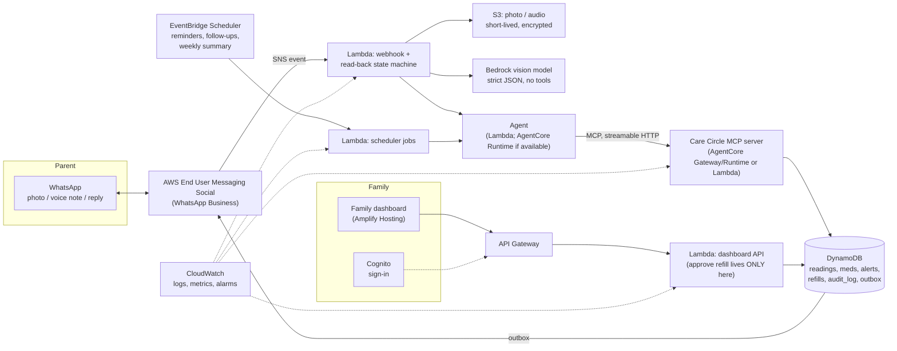

# AWS architecture (production design)

**Status, stated plainly:** Care Circle runs today as a local demo (mock mode, SQLite, one
machine). **Nothing is deployed on AWS, and no AWS service is called by this code.** This page
shows how each part would map to AWS in production, all in **Asia Pacific (Mumbai),
`ap-south-1`**, and marks for every row what exists in the repo today and what is design only.

The code was built for this move: every provider sits behind an adapter picked in `.env`
(`CHANNEL`, `LLM_PROVIDER`, `STORAGE`, `VOICE`, `CALL_PROVIDER`), and `APP_MODE=aws` already
switches off the demo-only controls.

## Diagram (target)

## Component map

Legend: **Built** = working code in this repo. **Adapter ready** = the switch exists, the AWS
implementation does not. **Design** = not started.

| Component | Today (in this repo) | Production on AWS (ap-south-1) | Status |
|---|---|---|---|
| WhatsApp channel | Web simulator; Telegram adapter; Twilio WhatsApp Sandbox adapter (`app/channels/*`, not tested live) | **AWS End User Messaging Social** (WhatsApp Business account linked through AWS; inbound messages arrive as SNS events). Mumbai is listed as a supported Region. | Design (new channel adapter needed) |
| Webhook + read-back state machine | FastAPI app (`app/api/webhooks.py`, `app/conversation/*`) | **AWS Lambda** behind the SNS subscription (WhatsApp) and **API Gateway** (other webhooks) | Design (code is plain Python and would be reused) |
| Photo reader (vision) | `MockReader` (no keys) and `GroqReader` (real, tested live); `BedrockReader` is a **stub that raises `NotImplementedError`** (`app/reader/bedrock_reader.py`) | **Amazon Bedrock** vision model with the same strict JSON schema and **no tools**. Model to be chosen from those offered to India (in-country or cross-Region inference) and measured with `scripts/accuracy_test.py` first | Adapter ready (stub) |
| Photo / audio storage | Photos and voice notes are read in memory and dropped; TTS audio cached on local disk | **S3** with SSE-KMS, private, lifecycle rule deleting objects within a day; also hosts TTS voice notes so WhatsApp can fetch them (a public, short-lived URL is what voice notes on WhatsApp still need) | Design |
| Agent | Rule-based agent (`app/agent/rule_agent.py`) calling the MCP server through a real MCP client over streamable HTTP; tool allowlist | **Bedrock** model with tool calling, same allowlist, hosted on **Lambda** or **Amazon Bedrock AgentCore Runtime** (AgentCore availability in ap-south-1 to be confirmed; Lambda otherwise) | Design (an LLM agent is not built yet; `LLM_PROVIDER=bedrock` only affects the reader) |
| MCP server | FastMCP server, own process, localhost only (`mcp_server/*`); guardrails, consent checks, audit log; **no `approve_refill` tool** | **AgentCore Gateway/Runtime** or **Lambda** (stateless streamable HTTP) behind IAM auth, plus the planned shared-secret header between agent and server | Design |
| Database | SQLite (`app/storage/sqlite_store.py`) behind a `Store` interface (`app/storage/base.py`); `STORAGE=dynamodb` exists but raises "not implemented yet" | **Amazon DynamoDB** (on-demand), keyed by `parent_id`; point-in-time recovery; idempotent job claims via conditional writes | Adapter ready (interface only) |
| Scheduler | In-process loop every 30 s (`app/scheduler/jobs.py`), idempotent jobs, demo clock | **Amazon EventBridge Scheduler**: one cron schedule per medicine time in `Asia/Kolkata`, one-time schedules for the +30 min follow-up, weekly cron for the Sunday summary, each invoking a Lambda that runs the same job code | Design (job logic built and tested) |
| Dashboard API | FastAPI routes (`app/api/dashboard.py`); refill approval exists only here | **API Gateway** + **Lambda**; approval stays the only path to an approved refill | Design (code reused) |
| Family sign-in | Demo token + HMAC-signed session (`app/api/auth.py`) | **Amazon Cognito** user pool; each family member a user, mapped to their `family_id` server-side | Design |
| Family dashboard (web) | React + Vite build served by FastAPI at `/dashboard/` | **AWS Amplify Hosting** (static build) | Design |
| Voice notes (TTS / STT) | ElevenLabs adapters (`app/voice/*`, mocked in tests; TTS + STT checked live once, 23 Nov 2026); mock voice in the browser | Unchanged: ElevenLabs over HTTPS from Lambda; keys in **AWS Secrets Manager** | Built (provider), design (AWS hosting) |
| Red-alert phone call | Mock call card; Twilio call adapter (not tested live) | Unchanged: Twilio (or an ElevenLabs agent over Twilio) from Lambda | Built (adapter), design (AWS hosting) |
| Logs, metrics, audit | `audit_log` table shown on the dashboard; process logs to stdout | `audit_log` in DynamoDB; **CloudWatch** logs, metrics and alarms (failed alerts, tool refusals), plus an AWS Budgets alarm | Design |
| Secrets | `.env` (git-ignored) | **AWS Secrets Manager** / SSM Parameter Store, read by Lambda roles with least privilege | Design |
| Region | `AWS_REGION=ap-south-1` default in config | Everything in **ap-south-1** (Mumbai) to keep Indian health data in India; any cross-Region inference limited to an India geography profile where offered | Config only |

## What `APP_MODE=aws` already does

- The demo clock is fixed at zero offset (`app/clock.py`).
- **Reset demo**, the demo-clock buttons and **Simulate low stock (demo)** are refused with
  HTTP 403 (`app/api/simulator.py`, `app/api/dashboard.py`).

That is the full extent of AWS-specific behaviour in the code today.

## Guardrails that carry over unchanged

These live in the MCP server and the API, not in a prompt, so moving to Bedrock does not weaken
them:

- No `approve_refill` tool; refill approval only through the dashboard API after a family
  member's click.
- `log_reading` stores readings unconfirmed; only the parent's "1" confirms them.
- `alert_family` re-checks the doctor's limits server-side; the repeat-BP rule; red alerts only
  on confirmed readings.
- The parent's identity comes from the server-side sender mapping (`_meta`), never from model
  output.
- Consent checked on every tool; every call written to `audit_log`.

## Before building it (open items)

1. Confirm which Bedrock vision model is offered to India in ap-south-1 (in-country or India
   cross-Region inference) and measure it on real photos with `scripts/accuracy_test.py`.
2. Confirm whether Bedrock AgentCore Runtime/Gateway is available in ap-south-1; if not, host
   the agent and MCP server on Lambda.
3. Onboard a WhatsApp Business account in AWS End User Messaging Social and get utility
   templates approved for alerts outside the 24-hour window.
4. Write the DynamoDB `Store` and point the existing storage tests at it as well.
5. Set an AWS Budgets alarm before creating anything; ask the team before any paid resource.
